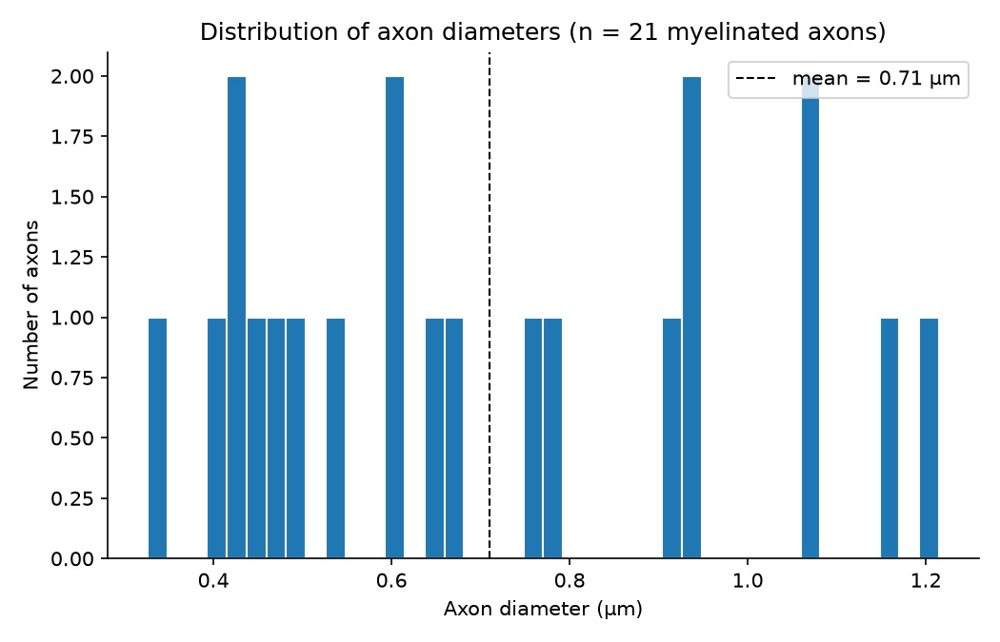
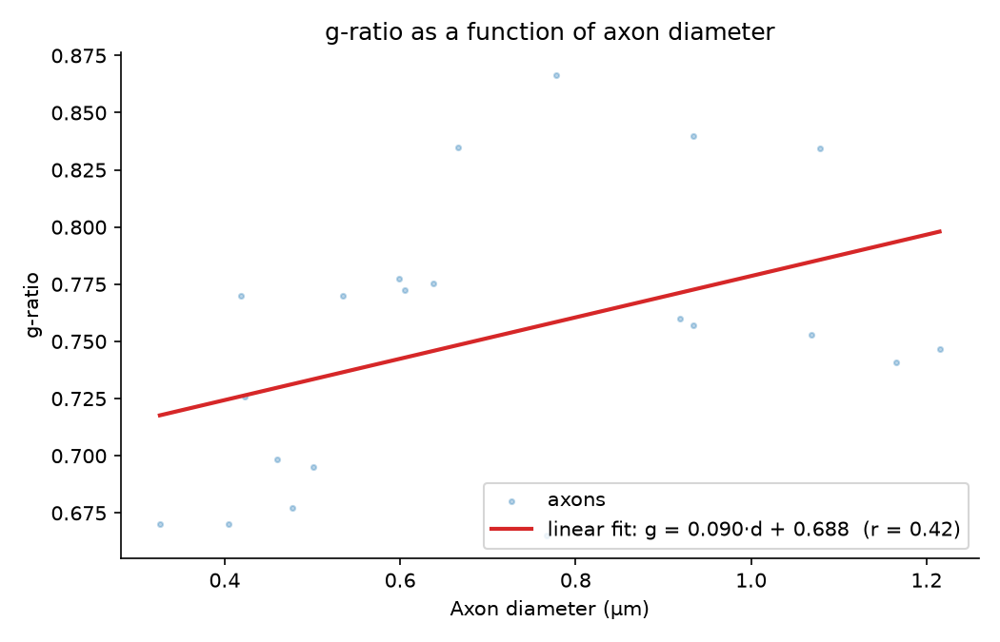

# Axon caliber and myelination in the mouse corpus callosum

_ING8100, Lab 3. Team 3: Youssef Laatar, Paul Hoareau._

## 1. Research question

In myelinated white matter, the g-ratio (inner axon diameter divided by the outer diameter of the myelinated fiber) summarizes how thick the myelin sheath is relative to the axon it wraps. It is a key quantity for nerve conduction and a common biomarker of demyelination.

**Question:** in the splenium of the mouse corpus callosum, how are axon diameter and g-ratio distributed, and are larger axons relatively more or less myelinated than smaller ones?

We answer it with fully automatic measurements: axons and myelin are segmented with AxonDeepSeg (ADS), and the g-ratio and diameter of each axon are computed from the masks.

## 2. Dataset

We use the dataset our team deposited on Borealis in Lab 2: _TEM Images of Corpus Callosum in Control and Cuprizone-Intoxicated Mice with Axon and Myelin Segmentations_ ([doi:10.80240/FK2/IFEI6R](https://demo.borealisdata.ca/dataset.xhtml?persistentId=doi:10.80240/FK2/IFEI6R), CC-BY 4.0). It is a re-deposit of DANDI:001436, from the study by Jelescu et al. (NeuroImage, 2016).

- Transmission electron microscopy (TEM) images of the splenium of the corpus callosum, 142 samples from 18 female C57BL/6 mice (BIDS format).
- Pixel size 2.36 nm (0.00236 µm), field of view about 6 x 9 µm².
- Manual axon and myelin masks are provided for every image. We do not use them in this analysis, since our pipeline segments the images automatically.
- Mice were either controls or cuprizone-intoxicated, but **the group of each mouse is not recorded in the dataset**, so we do not compare groups.

**Scope.** We analyze a single image, `sub-nyuMouse11_sample-0006_TEM.png`, to keep compute time reasonable: segmenting one image with ADS takes about 15 minutes on CPU, and the dataset holds 142. The pipeline itself works on any number of images, and `analyze.py` accepts several tables at once.

## 3. Methodology

The pipeline runs in four scripts, from the repository root, inside the virtual environment created by `scripts/setup_env.sh` (Python 3.11, ADS v5.5.0, exact versions in `requirements.txt`).

1. **Download** (`scripts/data_setup.sh`): fetches the images from Borealis through its API into `data/raw/`. Data is never committed to the repository.
2. **Segmentation** (`scripts/segment.py`): runs the ADS generalist model (nnU-Net) on each image and saves an axon mask and a myelin mask in `results/segmentation/`.
3. **Morphometrics and cleaning** (`scripts/morphometrics.py`): computes one row per axon with ADS (equivalent circular diameter, myelin thickness, g-ratio, areas, eccentricity), with units in the column names. This is our preprocessing step. It removes axons whose measurements are not reliable:
   - axons touching the image border (only partially visible, so underestimated),
   - axons without a myelin measurement (unmyelinated or segmentation error),
   - g-ratios outside ]0, 1[ (physically impossible),
   - objects smaller than 0.3 µm in diameter (almost always segmentation noise).
4. **Analysis** (`scripts/analyze.py`): computes the summary indicators per image and over all axons, and produces the two figures below.

Indicators: number of axons kept, mean and standard deviation of the axon diameter, mean and standard deviation of the g-ratio, mean myelin thickness, and Pearson correlation between axon diameter and g-ratio.

## 4. Results

On the test image, ADS detected 29 axons. 6 touched the border and 2 were outliers, which leaves **21 axons** for the analysis.

| Indicator | Value |
|---|---|
| Axons kept | 21 |
| Axon diameter (mean ± SD) | 0.71 ± 0.27 µm |
| g-ratio (mean ± SD) | 0.75 ± 0.06 |
| Myelin thickness (mean) | 0.11 µm |
| Correlation diameter / g-ratio (Pearson r) | 0.42 |

_Table 1. Summary indicators (`results/summary_overall.csv`)._

_Figure 1. Distribution of axon diameters for the myelinated axons kept after cleaning. The dashed line is the mean._

Figure 1 shows that myelinated axons in the splenium are small, mostly between 0.3 and 1.2 µm. With only 21 axons the histogram is sparse, so the shape of the distribution cannot be judged from this image alone.

_Figure 2. g-ratio of each axon as a function of its diameter, with a linear fit._

Figure 2 answers the second part of the question. The g-ratio increases with axon diameter (r = 0.42): larger axons have a relatively thinner myelin sheath compared to their caliber. This trend is the one usually reported in central nervous system white matter. With 21 axons from a single image, however, it is only indicative and would need more images, ideally from every mouse, to be confirmed.

## 5. Discussion and limitations

**Comparison with the literature.** Our values are of the same order as those reported from electron microscopy of the adult mouse corpus callosum. West et al. (2015) measured a mean axon diameter of 0.56 ± 0.32 µm and a mean g-ratio of 0.81 ± 0.07 in control mice, in the genu and midbody ([doi:10.1016/j.dib.2015.08.022](https://doi.org/10.1016/j.dib.2015.08.022)). Our mean diameter is somewhat larger (0.71 µm). This is partly expected, since our cleaning step removes objects smaller than 0.3 µm, which excludes the smallest axons and raises the mean. Our mean g-ratio is lower (0.75), meaning thicker myelin relative to the axon. This could come from the region (splenium vs genu and midbody), from the mouse, or from how the automatic segmentation places the myelin boundary. One image is not enough to tell these apart. West et al. also found that the g-ratio increases with axon diameter, following a non-linear (log-linear) curve. The positive correlation we observe (r = 0.42) is consistent with that trend, although a linear fit cannot capture its curvature.

**Limitations.**

- *Fully automatic measurements.* Segmentation errors propagate directly into the indicators: two touching axons merged into one inflate the diameter, and a thin myelin sheath that is partly missed biases the g-ratio upward. The dataset includes manual axon and myelin masks for every image. Comparing them with the ADS masks would quantify this error, and is the most direct way to validate the pipeline.
- *Small sample.* We analyzed a single image from one mouse, which leaves 21 axons after cleaning. The results describe this sample, not the splenium of the mouse population, and the correlation estimate is unstable at this size. The pipeline already accepts any number of images, so extending the analysis is only a matter of compute time (about 15 minutes per image on CPU).
- *Unknown experimental group.* The dataset does not record which mice were controls and which were cuprizone-intoxicated. Without that information, our values cannot be interpreted as healthy reference values, and pooling several mice would mix the two conditions. Since demyelination raises the g-ratio, this mixing would inflate the variability between mice.
- *Diameter definition.* Axon diameter is computed as the diameter of a circle with the same area. For elongated or obliquely cut axons, this underestimates the true caliber, which in turn affects the g-ratio.
- *Cleaning thresholds.* The 0.3 µm minimum diameter and the exclusion of border axons are reasonable but arbitrary choices. Both shift the distribution toward larger axons, and other thresholds would give slightly different indicators.

## 6. Reproducing these results

See the [README](README.md#instructions-for-replicators). In short: `bash scripts/setup_env.sh`, `bash scripts/data_setup.sh`, then run `segment.py`, `morphometrics.py` and `analyze.py` in that order.
